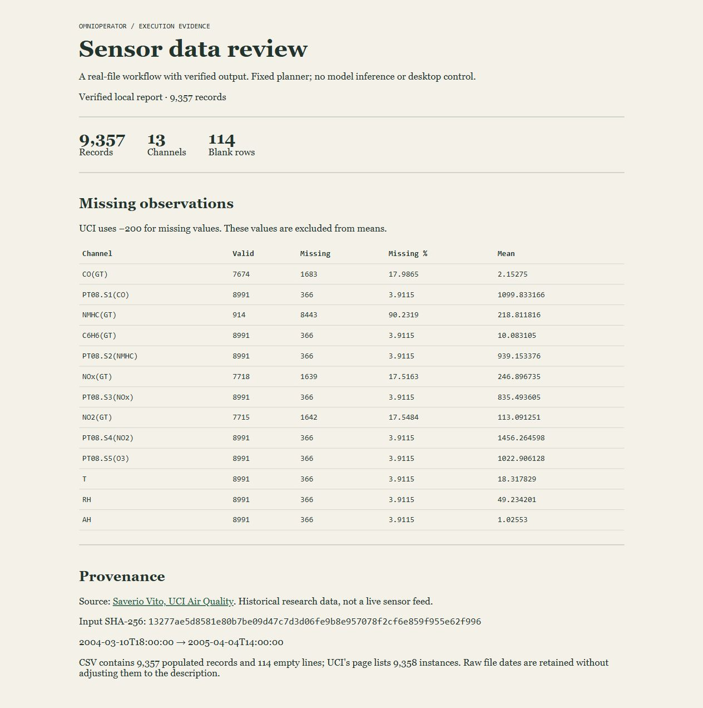

# OmniOperator

OmniOperator separates proposed actions from execution. Each action passes through a policy check, and a verifier checks the result before the run can count as successful.

The examples include a text desktop simulator and a CSV review workflow with a local report page. Both use fixed action plans. This release does not provide real desktop control, image understanding, OCR, OS isolation, or a demonstrated autonomous language-model agent.

## Run locally

Python 3.9+; the demo has no third-party runtime dependencies.

```sh
python -m omnioperator.demo
python -m pip install -e ".[dev]"
python -m pytest
python -m scripts.validate
```

The demo opens a simulated settings field and enters `Peyman`. A separate verifier checks the final state. `reports/acceptance.json` records the actual integration run, including negative cases. No API credentials or paid calls are needed.

## Real-data demonstration

```sh
python -m scripts.prepare_data
python -m scripts.run_real
python -m omnioperator.review_server
# Open http://127.0.0.1:8793
# Optional separate numeric cross-check:
python -m pip install -e ".[dev,evaluation]"
python -m scripts.real_acceptance
```



The fixed-plan agent reads a real UCI field-sensor CSV, checks its SHA-256, inspects missing values, and writes a JSON report. A separate pandas implementation checks the numeric results. The run reads and writes real files. Planning is scripted; the browser page displays the resulting report.

The recorded run processed 9,357 rows across 13 numeric columns and skipped 114 empty rows. NMHC(GT) was missing in 90.2319% of the populated rows. All 13 missing-count and mean calculations agree with pandas. Four actual loopback HTTP checks passed. Unit/regression suite: 43 tests passed on Python 3.12.14. See [raw results](reports/real-workflow.json).

Raw CSV is excluded from the release because UCI's current license label and legacy usage note conflict; see [data provenance](data/NOTICE.md). The report viewer uses an already generated report and does not access a sensor feed.

## Design

`Observation → adapter proposal → policy → normalized parameters → controller → environment → state verifier`

- `core/agent.py`: bounded episode, action history, error stops, per-episode token delta. Adapter completion without a verifier is `unverified_done`, never verified success.
- `core/controller.py`: dispatch and execution trace; uses policy-returned parameters, preserving sanitization decisions.
- `safety/guardrails.py`: conservative validation, bounds checks when configured, text limits, confirmation requirements. Shell is disabled by default.
- `core/vision.py`: text-framebuffer lookup and grid representation. Names are retained for compatibility; this is not image OCR.
- `adapters/mock_adapter.py`: deterministic scripts with rough token estimates, not measured model usage.
- `adapters/openai_vlm.py`: optional legacy text-observation API adapter. Its response parser is locally tested; live API inference and image input are not validated here.
- `evaluation/benchmark.py`: task-provided outcome oracles; no blanket approval from a flag.

## Safety boundaries

Regex command rewriting is not a filesystem sandbox. This version removes that behavior. `allow_shell=True` explicitly enables a capability requiring per-call confirmation; a real backend must independently enforce OS isolation. Do not connect it to your normal shell as a security boundary.

Labels supplied by the proposing adapter are untrusted. Label matching cannot guarantee safe GUI interactions. Text entry and hotkeys can have contextual effects. The desktop simulator has no host access. The CSV backend reads its configured source and writes its configured report; those paths come from the calling code. It exposes no network or shell actions. Real desktop operation needs trusted target metadata, action-specific approvals, and isolation before deployment.

The time budget is checked between phases; it cannot interrupt a blocking adapter/backend call. Add backend-specific timeouts before deployment. The trace is in memory and is not a tamper-proof security audit. Do not place secrets in observation/history logs.

## Evidence and limitations

See [technical review](reports/TECHNICAL_REVIEW.md) and [recorded acceptance results](reports/acceptance.json). Scripted task success demonstrates wiring and state transitions, not general task intelligence. There is no external benchmark score or claim of production readiness.

## License

MIT; original attribution is retained in LICENSE.
